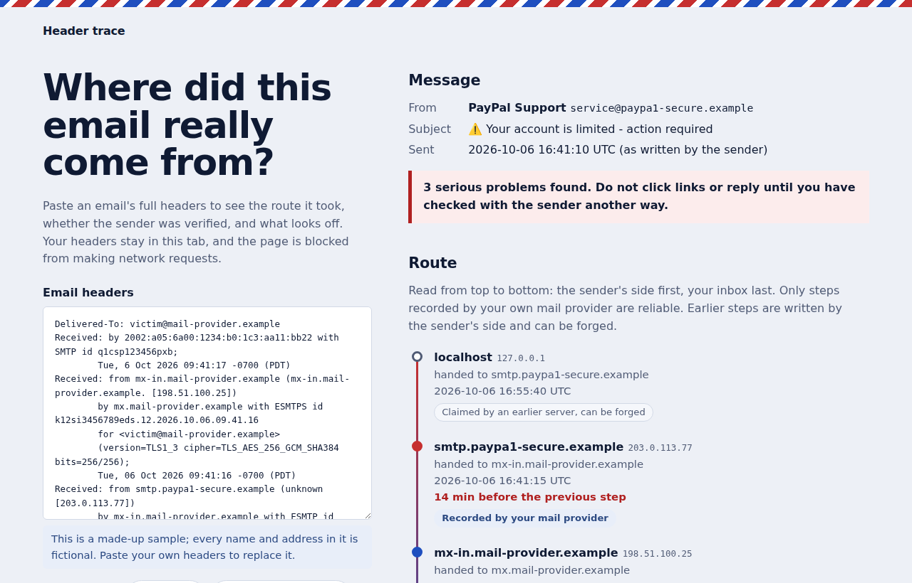
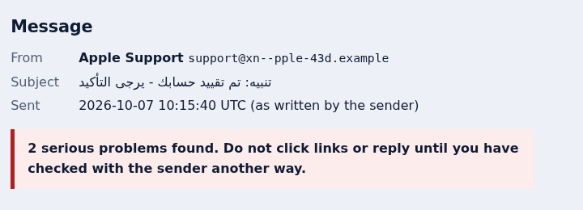

# ✉️ Header trace

A web page that reads an email's headers and shows **where the message really came from**: the route it took, whether the sender was verified, and what looks off. Everything runs in the browser, and the page is blocked from making network requests.

## What it checks

- **Route.** Rebuilds the chain of servers from the `Received` lines, oldest first, with the delay at each step. It marks which steps were recorded by *your own* mail provider (reliable) and which were written by the sender's side (forgeable), and flags timestamps that run backwards.
- **Sender verification.** Reads the SPF, DKIM and DMARC results your provider recorded, and notices when a check *passed for the wrong domain*. Anyone can pass SPF for a domain they own, so a pass is only meaningful when it lines up with the visible From address.
- **Address mismatches.** Reply-To or bounce addresses on a different domain, a display name that contains another address, duplicate `From` headers.
- **Look-alike domains.** Digit and letter swaps (`paypa1`), one-character misspellings, a brand name buried inside another domain, and **homograph attacks**: it decodes `xn--` Punycode and flags words that mix Latin with Cyrillic or Greek letters.
- **Encoded text.** Decodes RFC 2047 subjects and display names, including Arabic.

The second sample above shows why the checks are layered: SPF, DKIM and DMARC all *pass*, because the attacker owns the fake domain and set it up properly. Only the look-alike analysis exposes it.

## Design decisions

- **No dependencies and no network.** The whole tool is one HTML file built from TypeScript with no packages. The page carries a Content-Security-Policy that blocks outbound connections, so the privacy claim can be verified in the browser's Network tab rather than taken on trust.
- **Header data is only ever displayed as text.** Values are inserted as text nodes, never as HTML, so markup or script hidden in a header cannot run.
- **Hostile input is expected.** Headers are attacker-controlled. Every pattern is length-bounded, input is capped at 200,000 characters, and the test suite feeds it pathological inputs (unbalanced brackets, floods of encoded words, megabyte-long tokens) and requires a fast, non-throwing result.
- **Findings with evidence, not a score.** There is deliberately no "87% phishing" figure. Each finding says what was seen, why it matters, and quotes the header lines it came from.
- **Pure checks.** Each check is a function from parsed headers to a list of findings, which keeps them independently testable.

## Tests

95 automated tests using Node's built-in runner: parsers, each check, the three sample messages, and hostile-input and prototype-pollution cases. The UI was exercised in Chromium (console clean, zero network requests, injected `<script>` and `` rendered as plain text).

## Limitations

- **It reads verification results; it does not recompute them.** Re-verifying DKIM needs the exact original message and live DNS, and SPF needs the connecting IP's DNS records. The tool trusts the topmost `Authentication-Results` (written by the receiving server) and ignores lower ones. If a provider records none, it says so.
- **Tested on constructed headers, not a corpus of real mail.** The samples are fictional and the checks follow the RFCs, but real providers format `Received` and `Authentication-Results` lines in many ways. Expect gaps with unusual formats.
- **Look-alike detection is a heuristic.** It compares against a short built-in list of well-known brands, uses a partial table of confusable characters, and approximates the Public Suffix List with common two-part suffixes. It will miss brands that are not listed and can raise false alarms, for example a legitimate domain that happens to sit one letter away from a brand.
- **No DNS lookups, by design.** That means no domain age, blocklists, or reverse-DNS verification.
- **Headers only.** It cannot judge links, attachments or wording.
- **Thresholds are judgement calls.** Two minutes of tolerated clock skew, six hours for a "long delay" and 24 hours for a Date mismatch are reasonable defaults, not standards.
- **Browser support.** Checked in Chromium only.

## Roadmap

Ideas for future versions:

- Test the checks against a wider set of real-world headers from different providers (Gmail, Outlook, Yahoo, Exchange) and fix the formats they handle differently.
- Let readers extend the list of brands used for look-alike checks without editing the code.
- Add an Arabic interface with right-to-left layout.
- Export the findings as a short report that can be attached to a phishing report.

## Author

Built by REMAS ([@rllhv](https://github.com/rllhv)).
